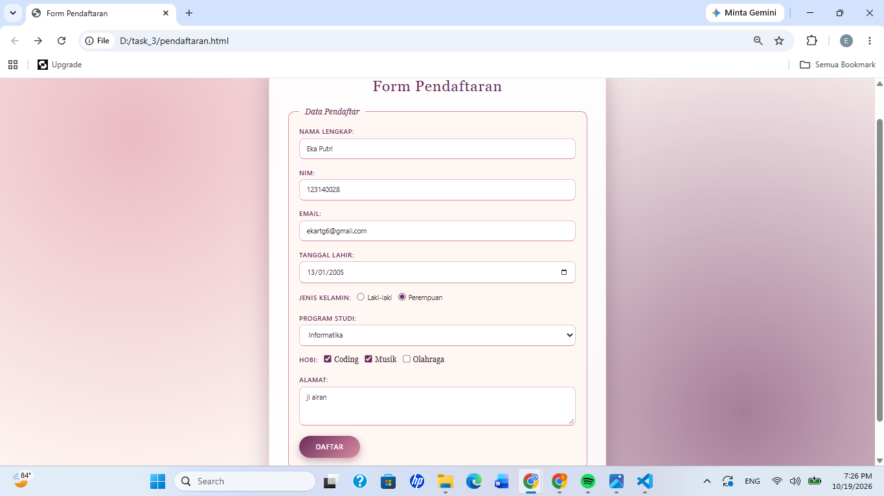
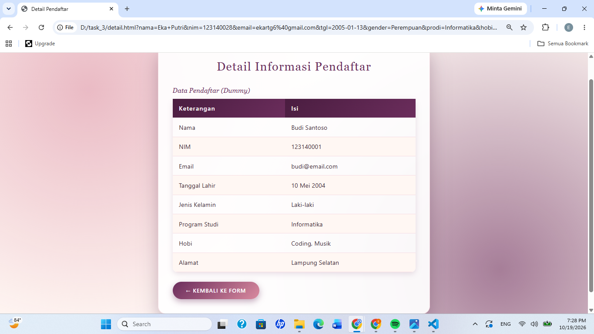

# Tugas Individu 3 - Pemrograman Web

Nama  : Eka Putri
NIM   : 123140028
Kelas : PAW RA

## Deskripsi
Dua halaman web sederhana: halaman pendaftaran (form dengan method GET)
dan halaman detail pendaftar (data dummy). Data dikirim lewat query string.

## Isi Folder
- pendaftaran.html : halaman form pendaftaran
- detail.html      : halaman detail pendaftar
- style.css        : styling untuk kedua halaman
- FormPendaftaran.png, DetailPendaftaran.png : screenshot tampilan halaman

## Screenshot

### Halaman Pendaftaran

### Halaman Detail Pendaftar

